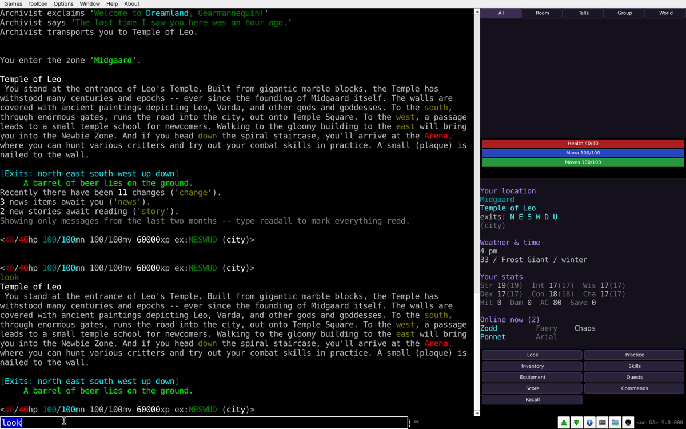

# DreamLand for Mudlet

[English](#english) · [Українська](#українська) · [Русский](#русский)

## English

The [DreamLand](https://dreamland.rocks) interface for [Mudlet](https://www.mudlet.org): health, mana and moves bars, an enemy bar in a fight, your location, weather and time, quests, group, affects, stats, who is online, command buttons and chat tabs. The same panels as the web client, in English, Ukrainian or Russian, whichever language you play in.

### Install

Create a Mudlet profile with server `dreamland.rocks`, port `9000`, and connect. The game offers the package itself; say yes. It updates itself the same way.

### Commands

- `dl` shows help.
- `dl hide` hides the side panel. The game text stays exactly as it is, so the panel is never the only place to read anything.
- `dl show` brings it back.
- `dl width 30` sets the panel width, 15 to 60 percent of the window.

Mudlet's generic mapper is removed on a fresh profile, because DreamLand has no map for it and it keeps asking for a prompt pattern. If you already drew a map with it, it stays.

## Українська

Інтерфейс [DreamLand](https://dreamland.rocks) для [Mudlet](https://www.mudlet.org): смужки здоров'я, мани і кроків, смужка ворога в бою, де ти є, погода і час, завдання, група, впливи, параметри, хто зараз у світі, кнопки команд і вкладки чату. Ті самі панелі, що й у веб-клієнті, тією мовою, якою ти граєш: українською, англійською чи російською.

### Встановлення

Створи профіль у Mudlet: сервер `dreamland.rocks`, порт `9000`, і підʼєднайся. Гра сама запропонує пакет, погоджуйся. Оновлюється він так само, сам.

### Команди

- `dl` показує довідку.
- `dl hide` ховає бічну панель. Текст гри лишається таким, як був, тож панель ніколи не єдине місце, де щось написано.
- `dl show` повертає її.
- `dl width 30` задає ширину панелі, від 15 до 60 відсотків вікна.

Generic mapper від Mudlet на новому профілі видаляється: карти для нього в DreamLand нема, а він увесь час просить шаблон prompt'а. Якщо ти вже намалював ним карту, він лишається.

## Русский

Интерфейс [DreamLand](https://dreamland.rocks) для [Mudlet](https://www.mudlet.org): полоски здоровья, маны и шагов, полоска противника в бою, где ты находишься, погода и время, задания, группа, воздействия, параметры, кто сейчас в мире, кнопки команд и вкладки чата. Те же панели, что и в веб-клиенте, на том языке, на котором ты играешь.

### Установка

Создай профиль в Mudlet: сервер `dreamland.rocks`, порт `9000`, и подключись. Игра сама предложит пакет, соглашайся. Обновляется он так же, сам.

### Команды

- `dl` показывает справку.
- `dl hide` прячет боковую панель. Текст игры остаётся как был, так что панель никогда не единственное место, где что-то написано.
- `dl show` возвращает её.
- `dl width 30` задаёт ширину панели, от 15 до 60 процентов окна.

Generic mapper от Mudlet на новом профиле удаляется: карты для него в DreamLand нет, а он всё время просит шаблон prompt'а. Если ты уже нарисовал им карту, он остаётся.

## For developers

The package is Lua in `src/`, assembled into `Dreamland.xml` by `python3 build.py`. Commit both: the deploy workflow refuses an out-of-date `Dreamland.xml`. To try a change, run `lua installPackage("/path/to/Dreamland.xml")` in Mudlet after `lua uninstallPackage("Dreamland")`.

Everything comes from GMCP, never from matching game text: `Dreamland.Prompt` (the web client's prompt object, sent as changes only), `Comm.Channel.Text` for chat, plus `Char.Vitals`. The server side lives in `plug-ins/gmcp` of [dreamland_code](https://github.com/dreamland-mud/dreamland_code).

A push to `master` that changes the package builds `Dreamland.zip` on `gh-pages` and bumps `downloads/version`. The game server reads that version and offers the new zip to every Mudlet player through GMCP `Client.GUI`.
